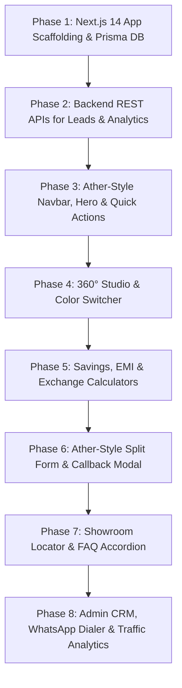

# Implementation Blueprint: ARS Motors E-Luna EV Bike Single-Page Website with Ather-Inspired Premium UI, 360° Interactive Studio, EMI & Exchange Engine, Admin Lead CRM & Traffic Analytics

## 1. Executive Summary & Design System

### 1.1 Inspiration: Ather Energy Design System
The website adopts the clean, minimalist, high-tech automotive aesthetic pioneered by **Ather Energy (`atherenergy.com`)**:
- **Frosted Glass Sticky Header (`backdrop-blur-md`)**: Floating pill design with showroom selector (`Salem: Seelanaickenpatti | Madathur 📍`), model badge (`E-Luna PRO X3 [New]`), and instant `English | தமிழ்` bilingual toggle.
- **Cinematic Motion Hero**: Edge-to-edge full-bleed visual layout with confident typography (*"Ride in Style. Built for Bharat."* / *"ஸ்டைலாக செல்லுங்கள் நம் லூனாவில்!"*) and translucent pill CTAs.
- **Quick Actions Dock**: Horizontal floating pills for instant navigation:
  1. 🛵 *Book Test Ride*
  2. 💰 *Fuel Savings Calculator* (₹56,652/yr)
  3. 💳 *EMI Calculator* (From ₹2,199/mo)
  4. 🔄 *360° Interactive Studio*
  5. 🔄 *Petrol Exchange Estimator*
  6. 📍 *Locate Salem Showrooms*
- **Ather-Style Split "Get in Touch" Lead Section**: Left-aligned low-friction lead capture form paired with a right-aligned transparent cutout render of the E-Luna angled toward the user.
- **Global "Talk to us, directly" Callback Modal**: Triggered by a persistent floating pill button in the bottom-right corner (**"Request a call back"**) at any scroll depth.
- **Interactive 360° Studio**: Smooth turntable drag/touch rotation with live color switcher (5 colors) and hotspot annotations on the motor, battery, chassis, and cargo rack.

---

## 2. Technical Stack

| Layer | Recommended Choice | Justification |
|---|---|---|
| **Framework** | **Next.js 14+ (App Router)** | Full-stack architecture: React Server Components for SEO and API routes for the backend in a single deployable repository. |
| **Language** | **TypeScript** | Strict type safety for leads, analytics telemetry, and component props. |
| **Styling & Motion** | **Tailwind CSS + Framer Motion** | Ather-style curved corners (`rounded-2xl`, `rounded-full`), soft neutral grays (`bg-neutral-50`, `bg-neutral-900`), and ARS Electric Green/Blue accents. |
| **360° Visualizer** | **HTML5 Canvas Turntable Engine** | Zero-lag 36-frame interactive rotation with touch/drag support, fallback to 3D `@google/model-viewer`. |
| **Database & ORM** | **Prisma ORM + SQLite (Local Dev) / PostgreSQL (Cloud)** | Fully typed schema for Leads, PageViews, Showrooms, and Admin credentials. |
| **Admin Dashboard** | **Tailwind + Recharts** | Real-time lead pipeline, conversion rates, 1-click WhatsApp dialer, branch assignment, and visitor traffic analytics. |
| **Localization** | **Lightweight Client i18n Dictionary** | Instant zero-refresh toggle between English and Tamil (தமிழ்). |

---

## 3. Master Page Architecture & Customer Journey

```
[ Frosted Glass Header: ARS Motors Logo | E-Luna PRO X3 [New] | Salem 📍 | EN/தமிழ் | Call: 90253 80626 | Book @ ₹1000 ]
                                              │
[ 1. Full-Bleed Cinematic Hero: "ஸ்டைலாக செல்லுங்கள் நம் லூனாவில்!" + Value Badges (10p/km, 5-Yr Warranty) ]
                                              │
[ 2. Quick Actions Dock: Book Test Ride | Savings Calc | EMI Calc | 360° View | Exchange | Locate Showrooms ]
                                              │
[ 3. Ather-Style 360° Studio: Interactive Turntable + 5 Color Switcher + Engineering Hotspots ]
                                              │
[ 4. Dual Use-Case Showcase: Personal Daily Commuter vs. Heavy-Duty Commercial Cargo (150kg / Detachable Seat) ]
                                              │
[ 5. Fuel Savings Calculator: Interactive Slider (Save ₹56,652/year vs. Petrol) ]
                                              │
[ 6. Interactive EMI & Finance Calculator: Down Payment + Tenure Slider (Starting @ ₹2,199/month) ]
                                              │
[ 7. Old Petrol Two-Wheeler Exchange Estimator: Upgrade from TVS XL, Splendor, Activa for Extra Bonus ]
                                              │
[ 8. Home 3-Pin Charging Guide: 4-Hr Full Charge, Standard 5A/15A Socket, No Charging Station Needed ]
                                              │
[ 9. 14 Core Feature Cards (Steel Chassis, CBS, LED, Detachable Seat, 16" Wheels, USB Charger) ]
                                              │
[ 10. Accessories Showcase ("Pair Your E-Luna"): Heavy Delivery Crates, Mobile Mount with USB, Seat Covers ]
                                              │
[ 11. Technical Specifications Comparison Matrix ]
                                              │
[ 12. Tamil Nadu EV Policy Perks: 100% Road Tax Exemption + Zero Registration Fee Badge ]
                                              │
[ 13. Ather-Style Split "Get in Touch" Section (Left Form with ₹1,000 Token Booking / Test Ride + Right E-Luna Render) ]
                                              │
[ 14. Brochure Download Lead-Magnet Modal: Capture Name/WhatsApp to download official PDF ]
                                              │
[ 15. Dual Dealership Showroom Cards: Seelanaickenpatti Bypass & Madathur Bus Stop + 1-Click Google Maps Navigation ]
                                              │
[ 16. Accordion FAQ Section + Minimal Footer & Privacy Notice ]
                                              │
[ Global Floating Pill: "Request a call back" -> Opens "Talk to us, directly" Modal ]
```

---

## 4. Detailed Component Specifications

### 4.1 Ather-Style Split "Get in Touch" Lead Section
- **Left Column (Form)**:
  - Header: **"Get in touch"** / Subtitle: *"Experience the power of E-Luna with a free home or showroom test ride."*
  - Dual Mode Tabs: `Book Free Test Ride` | `Pre-Book @ ₹1,000`
  - **Full Name** (Input)
  - **Phone Number** (`+91` fixed country prefix badge + 10-digit input)
  - **Pin Code or Area** (Input with auto-detect GPS icon and Salem preset pills: *Seelanaickenpatti, Elampillai, Suramangalam, Ammapet*)
  - **Pick your model** (Pill selector: `E-Luna PRO X3` / `Commercial Cargo Edition`)
  - **Preferred Color** (Color dot pills: Mulberry Red, Pearl Yellow, Night Star Black, Sparkling Blue, Oceanic Green)
  - **Submit Button**: Ather-style full-width pill button (`rounded-full`).
- **Right Column (Visual)**:
  - High-resolution transparent background render of the Kinetic E-Luna in a dynamic 3/4 front angle with subtle shadow and badge overlays.

### 4.2 Interactive 360° Studio
- 36-frame turntable rotation with drag, swipe, and auto-rotate modes.
- Color Switcher:
  - 🔴 Mulberry Red (மல்பரி சிவப்பு)
  - 🟡 Pearl Yellow (முத்து மஞ்சள்)
  - ⚫ Night Star Black (நைட் ஸ்டார் கருப்பு)
  - 🔵 Sparkling Blue (பெருங்கடல் நீலம்)
  - 🟢 Oceanic Green (மினுமினுப்பு பச்சை)
- Hotspot Pins: 1.2 kW BLDC Motor, 2.3 kWh Li-ion Battery, Combi Braking System, 16" Large Spoke Wheels, USB Charging Socket, Detachable Rear Carrier.

### 4.3 Fuel Savings Calculator
- Daily Distance Slider (10 km to 150 km/day, default 50 km).
- Formulas:
  - Petrol: ₹1.91 / km.
  - E-Luna: ₹0.096 / km (~10 paise/km).
  - Annual Savings Display: Up to **₹56,652/- saved per year**.

### 4.4 EMI & Finance Calculator
- Down Payment Slider: ₹5,000 to ₹30,000.
- Tenure: 12, 24, 36 Months.
- Estimated EMI from **₹2,199/month**.
- Finance Partners: Bajaj Finserv, HDFC Bank, IDFC First, Cholamandalam.

### 4.5 Petrol Two-Wheeler Exchange Estimator
- Step 1: Select current brand (TVS, Hero, Honda, Bajaj, Other).
- Step 2: Select age of vehicle (1-3 yrs, 3-6 yrs, 6+ yrs).
- Step 3: Instant estimated trade-in bonus + pre-fill exchange intent into the lead form.

### 4.6 Home Charging Guide
- 4-Hour Charging time via standard 10A fast charger.
- Compatible with regular 5A/15A 3-pin household wall sockets (no special charging station needed).

### 4.7 Dual Showroom Locator
- **Showroom 1**: 3/345, Seelanaickenpatti Bypass, Near Dharan Hospital, Salem - 636 201 (`90253 80626`).
- **Showroom 2**: Elampillai to Chinnappampatti Road, Madathur Bus Stop (`94432 40752`).
- 1-Click **"Open in Google Maps"** navigation button.

---

## 5. Admin Panel & CRM Architecture (`/admin`)

### 5.1 Lead Pipeline CRM
- **Status Filter**: `ALL` | `NEW` | `CONTACTED` | `TEST_DRIVE_SCHEDULED` | `BOOKED_TOKEN_1000` | `LOST`.
- **Branch Routing**: Automatically tags leads to **Seelanaickenpatti** or **Madathur** based on user locality.
- **Search Bar**: Quick search by customer phone number or name.
- **Sales Rep Actions**:
  - 🟢 **1-Click WhatsApp**: Opens prefilled message customized with customer name and selected color.
  - 📞 **1-Click Direct Call**: Starts phone call.
  - 📝 **Sales Notes & Follow-Up Date**: Record call summaries.
- **Data Export**: 1-Click CSV / Excel download.

### 5.2 Traffic Analytics & Attribution
- Real-time visitor counts (Today, 7 Days, 30 Days).
- Conversion rate percentage: `(Total Leads / Unique Visitors) * 100`.
- **Physical Flyer Attribution**: Detects visits from QR codes printed on physical brochures (`?utm_source=flyer_seelanaickenpatti` / `?utm_source=flyer_madathur`).

---

## 6. Database Schema Design (Prisma ORM)

```prisma
datasource db {
  provider = "sqlite" // Easily swappable to "postgresql" for cloud deployment
  url      = env("DATABASE_URL")
}

generator client {
  provider = "prisma-client-js"
}

model AdminUser {
  id           String   @id @default(uuid())
  email        String   @unique
  passwordHash String
  name         String
  role         String   @default("sales_executive")
  createdAt    DateTime @default(now())
}

model Lead {
  id              String      @id @default(uuid())
  name            String
  phone           String
  email           String?
  cityArea        String      @default("Salem")
  preferredColor  String?     // Red, Yellow, Black, Blue, Green
  inquiryType     String      @default("Test Drive") // "Test Drive", "Token Booking @ 1000", "Brochure Download", "EMI Inquiry", "Exchange"
  useCase         String      @default("Personal") // "Personal", "Commercial Cargo"
  exchangeBrand   String?     // e.g. "TVS XL", "Hero Splendor"
  assignedBranch  String      @default("Seelanaickenpatti") // "Seelanaickenpatti" or "Madathur"
  status          String      @default("NEW") // NEW, CONTACTED, TEST_DRIVE_SCHEDULED, BOOKED_1000, CONVERTED, LOST
  notes           String?
  source          String      @default("Website Direct") // Flyer QR, Google, WhatsApp, Direct
  utmSource       String?
  utmMedium       String?
  utmCampaign     String?
  createdAt       DateTime    @default(now())
  updatedAt       DateTime    @updatedAt
}

model PageView {
  id          String   @id @default(uuid())
  path        String   @default("/")
  referrer    String?
  userAgent   String?
  deviceType  String?  // Mobile, Desktop, Tablet
  ipHash      String?  // Anonymized unique visitor identifier
  utmSource   String?
  utmCampaign String?
  createdAt   DateTime @default(now())
}
```

---

## 7. Step-by-Step Implementation Roadmap



1. **Phase 1**: Initialize Next.js 14, Tailwind CSS, Lucide Icons, and Prisma ORM.
2. **Phase 2**: Implement `/api/leads` and `/api/analytics` backend endpoints.
3. **Phase 3**: Build Frosted-glass Sticky Header, Cinematic Hero fold, and Quick Actions dock.
4. **Phase 4**: Build 360° Canvas Turntable Visualizer with color switcher & hotspot pins.
5. **Phase 5**: Build the Fuel Savings Calculator, EMI Calculator, and Petrol Exchange Estimator.
6. **Phase 6**: Implement the Ather-style split "Get in Touch" form and floating "Talk to us, directly" callback modal.
7. **Phase 7**: Add dual showroom cards with 1-click Google Maps navigation, Home Charging guide, and FAQ accordion.
8. **Phase 8**: Build the secure `/admin` CRM dashboard with branch routing, lead management, 1-click WhatsApp messaging, and visitor traffic graphs.
